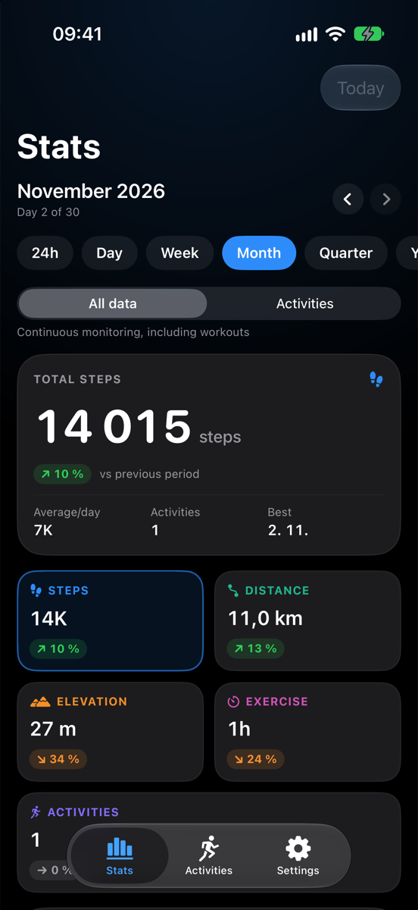

# StatsWorkout

An iOS app that turns Apple Health activity into clear, good-looking statistics — for the last 24
hours, a day, a week, a month, a quarter, a year or any custom range.

The app reads steps and workouts from HealthKit, aggregates them in a pure Swift domain layer and
renders them with Swift Charts: zoomable bar charts, a cumulative progress comparison and
press-and-drag value inspection. Every workout opens into a Health-style detail screen with its
route, splits and statistics.

> **Status:** 1.1.0. Statistics, charts, data scopes, background updates, workout detail with routes
> and the App Store pages are done. Widgets, goals and localisation are not implemented yet.

<p align="center">
  
</p>

## Features

- **Periods** — rolling 24 hours, calendar day (hourly buckets), week, month (default), quarter,
  year and custom ranges, with back/forward navigation, "Today" and locale-aware week boundaries.
- **Two data scopes** — *All data* (continuous Health monitoring: all-day steps, walking/cycling/
  swimming distance, ascent from flights climbed) or *Activities* (only samples inside workouts),
  switchable on the dashboard and remembered between launches.
- **Metrics** — steps, distance, elevation gain, exercise duration and activity count, each with a
  total, an average and a comparison against the previous period or the same period last year. A
  period in progress is compared only with the same elapsed part of the previous one.
- **Charts** — bar chart per period with pinch/button zoom, horizontal pan and tap/drag tooltips;
  cumulative "progress over time" chart with the comparison period overlaid.
- **Workout detail** — route map, duration, distance, average pace, elevation, energy, steps,
  average and maximum heart rate, plus per-kilometre (or per-mile) splits.
- **Automatic naming** — each workout is titled from when and where it happened: *"Your morning walk
  around Brtnice"*, *"Your night run around Okříšky"*. Time of day comes from the start time, the
  settlement from reverse-geocoding the centre of the recorded route. Names appear in the workout
  list too: rows start as *"Your afternoon run"* and rename themselves once the settlement is known,
  which is cached so it is geocoded only once. With no route or no place, the sentence simply drops
  the location.
- **Background updates** — HealthKit background delivery plus an on-device cache of daily totals, so
  the app is current when it opens and a month or year view does not re-read years of samples.
- **Settings** — distance (km/mi) and elevation (m/ft) units, default period, comparison baseline,
  cache status and a clear-cache action.
- **Demo data** — a deterministic generator (including plausible-looking routes around Vysočina
  towns) makes the app fully usable in the simulator without any Health data; on by default in
  simulator builds. Demo mode is always labelled — a "Demo" chip on the dashboard, a footer in the
  workout list and "Sample route — demo data" under the map — so generated data is never mistaken
  for a recording.

## Requirements

| Tool | Version |
| --- | --- |
| Xcode | 26 or newer (iOS 26 SDK) |
| iOS deployment target | 26.0 |
| [XcodeGen](https://github.com/yonaskolb/XcodeGen) | 2.46+ (`brew install xcodegen`) |

## Quick start

```bash
brew install xcodegen
make generate     # regenerate StatsWorkout.xcodeproj from project.yml
make open         # or open StatsWorkout.xcodeproj manually
```

Then pick an iPhone simulator and run. The app starts with demo data, so the dashboard is populated
immediately.

To run on a device, select your development team in *Signing & Capabilities*; the HealthKit
capability, `DEVELOPMENT_TEAM` and `NSHealthShareUsageDescription` are already configured.

### Common commands

```bash
make build         # build for the simulator
make test          # run the unit tests on the simulator
make shots         # capture the App Store screenshots (both devices)
make testflight    # archive and upload a build to TestFlight
make deploy-site   # publish the support/privacy site
make clean         # remove build products
```

If `xcodebuild` reports that it requires Xcode, point the toolchain at a full Xcode:
`make select-xcode` (or `sudo xcode-select -s /Applications/Xcode.app`).

## Switching from demo data to Apple Health

The first time the dashboard loads real data the app asks for Health access itself: the system
sheet lists the eight read types (steps, walking/running, cycling and swimming distance, flights
climbed, active energy, heart rate and workouts). If you skip the sheet, turn off **Use demo data**
in *Settings → Data source* and use *Settings → Apple Health → Request read access*.

HealthKit never reveals whether read access was granted, so an empty dashboard means "no data" or
"access denied" — the Health app shows the current permission under *Sharing → Apps → StatsWorkout*.

## Architecture

```
Features (SwiftUI views + @Observable view models)
    ↓
Domain (pure Swift: periods, aggregation, geometry, naming, formatting)
    ↑
Data (HealthSyncCoordinator + cache → HealthDataProviding → HealthKit | Mock)
```

- **Domain** has no HealthKit, MapKit or SwiftUI imports, so period maths, aggregation, route
  geometry and naming are unit-tested with a fixed `Calendar`, time zone and injected `now`.
- **`StatsAggregator`** turns samples into `AggregatedStats` for both data scopes in a single pass:
  bucket totals, period totals, previous-period totals for the elapsed window and a bucket-aligned
  previous series for the cumulative chart.
- **`RouteGeometry`** computes haversine distances, bounds (for framing the map), the centroid used
  for naming and per-kilometre splits with interpolated crossing times.
- **`WorkoutNaming`** turns a workout plus a place name into *"Your morning walk around Brtnice"*.
- **Data** is behind a `Sendable` protocol: `HealthKitDataSource` uses the async
  `HKSampleQueryDescriptor`, `HKStatisticsCollectionQueryDescriptor`, `HKStatisticsQueryDescriptor`
  and `HKWorkoutRouteQueryDescriptor` APIs; `MockHealthDataSource` produces stable pseudo-random
  data from a fixed seed.
- **`HealthSyncCoordinator`** caches daily totals in Application Support and only re-reads the days
  since the last sync (plus a two-day overlap that also catches edits and deletions), with a full
  re-read at most once a day. Day and 24-hour views read hourly data live, so the cache never holds
  hourly buckets.
- **`HealthKitBackgroundDelivery`** enables background delivery for the observed types and keeps one
  `HKObserverQuery` per type; HealthKit wakes the app when something changes.
- **`PlaceResolving`** reverse-geocodes the route centre through CoreLocation, cached per ~1 km;
  demo data resolves to the towns the synthetic routes are drawn around.

### Metric definitions

| Metric | All data | Activities |
| --- | --- | --- |
| Steps | all-day `stepCount` | steps recorded inside workouts |
| Distance | walking/running, cycling and swimming distance | workout distance |
| Elevation gain | flights climbed × 3 m, or the workout's ascent if larger | workout's recorded ascent |
| Exercise duration | workout duration | workout duration |
| Activities | number of workouts | number of workouts |

HealthKit does **not** attach step statistics to workouts (`HKWorkout.statistics(for: .stepCount)`
returns `nil`), so the *Activities* scope reads steps and distance from statistics queries scoped to
the workout time ranges; the workout's own statistics are only a fallback when no samples come back.

### Routes

A workout's route is **exactly what Apple Health recorded**: the `HKWorkoutRoute` samples belonging
to that workout, fetched through `HKQuery.predicateForObjects(from:)` so two workouts that overlap in
time can never mix their traces. Nothing is synthesised, smoothed or extended; workouts recorded
without a route simply show no map. Only demo data draws its own traces, and those are labelled in
the UI.

A workout is always resolved against the source that produced it: anything carrying a HealthKit
identity is read from HealthKit, so switching demo data on can never repaint a recorded workout with
a generated route. The demo labels follow the workout itself rather than the global switch.

### Splits

Splits are timed from the route — each boundary is interpolated from the timestamps of the two
surrounding points — but laid out along the distance HealthKit recorded for the workout. A GPS trace
is usually a few percent longer than that distance (corners, drift), so using the raw trace length
would push every split late; the calibration keeps the split count and the totals consistent with
the rest of the screen.

### Naming rules

| Input | Result |
| --- | --- |
| 07:00 walk, geocoded to Brtnice | Your morning walk around Brtnice |
| 23:30 run, geocoded to Okříšky | Your night run around Okříšky |
| 18:00 strength training | Your evening strength workout |
| 15:00 ride, no place resolved | Your afternoon ride |

Time of day: night 22–05, morning 05–12, afternoon 12–17, evening 17–22.

### Project layout

```
Sources/
  App/          app entry point, dependency container, settings, screenshot routes
  Domain/       models, period calendar, aggregation, route geometry, naming, formatters
  Data/         HealthKit + mock sources, workout mapping, sync coordinator, cache, places
  Features/     Dashboard, ActivityLog (list + detail + map), Settings
  DesignSystem/ theme, cards, pills, tiles
Tests/          Swift Testing suites
Supporting/     generated Info.plist and entitlements
Website/        the published support and privacy pages
screenshots/    App Store artwork captured from the simulator
tools/          PNG flatten/strip helpers and the icon generator
project.yml     XcodeGen specification (the source of truth for the project)
```

`StatsWorkout.xcodeproj` is generated and committed so the project opens without extra tooling.
Do not edit it by hand — change `project.yml` and run `make generate`. Run `make generate` after
adding or deleting source files.

## Testing

```bash
make test
```

62 tests cover period boundaries (including DST and leap years), bucket generation, aggregation for
both data scopes, partial-period comparison, unit formatting, the sample cache and refresh planning,
route geometry and splits, and workout naming. Chart cards, the map and the detail screen ship with
`#Preview`s backed by the mock data source, so visual work does not need a device.

CI runs the same build and test on every pull request (see `.github/workflows/ci.yml`).

## Contributing

Workflow, branch naming and PR requirements are described in [CONTRIBUTING.md](CONTRIBUTING.md).
`main` is protected: changes land through pull requests with a green CI run.

## Roadmap

- Widgets and Live Activity summaries
- Goal setting and rings
- Localisation (string catalogs are enabled, the app is English-only for now)
- Exporting a period as CSV

## Screenshots and artwork

`make shots` captures the App Store screenshots from clean simulators (6.1"/6.3" iPhone and
13" iPad) into [screenshots/](screenshots) — see [screenshots/README.md](screenshots/README.md) for
the frames and the debug-only launch arguments behind them (including `-screenshotWorkout` for the
detail screen). Icon candidates are in [docs/icons/](docs/icons); the shipped icon is the
pulse-trend one.

## Publishing

```bash
make testflight                    # build number defaults to a timestamp
make testflight BUILD_NUMBER=42    # or pass an explicit build number
```

The script archives in Release, signs with automatic provisioning for team `B592D69P29` and uploads
to App Store Connect. Prerequisites:

- Xcode is signed in with the team's Apple ID (*Xcode → Settings → Accounts*).
- An app record for `com.defik74.statsWorkout` exists in App Store Connect.

Bump `MARKETING_VERSION` in `project.yml` before shipping a new version.

## App Store pages

The privacy policy and support pages required for review live in [Website/](Website) and are
published at:

- https://stats-workout.ondralinek.cz/ — landing page (English, Czech under `/cs/`)
- https://stats-workout.ondralinek.cz/privacy.html
- https://stats-workout.ondralinek.cz/support.html

`make deploy-site` rsyncs `Website/` to `deploy@2.31.33.21:/var/www/stats-workout`. The app links to
the same pages from *Settings → About*. Listing copy for every App Store Connect field is in
[docs/app-store-listing.md](docs/app-store-listing.md); the submission process is in
[docs/app-store.md](docs/app-store.md).
