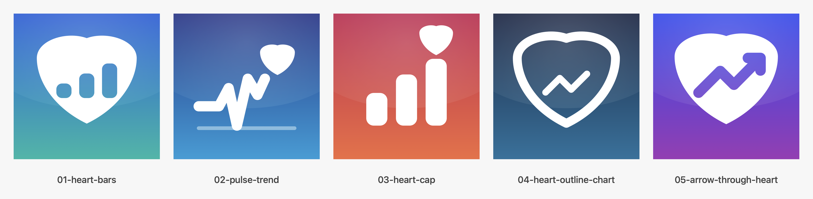

# App icon candidates

> **Chosen: 2 (`02-pulse-trend`)** — applied as
> `Resources/Assets.xcassets/AppIcon.appiconset/AppIcon.png` and as the icon on
> the website. The other directions are kept for reference.

Five directions, each combining a rising chart with a health signal. Rendered by
[tools/generate-icon-concepts.swift](../../tools/generate-icon-concepts.swift) at
1024 × 1024, opaque, square (Apple applies the mask).



| # | File | Idea | Reads at 60 px |
| --- | --- | --- | --- |
| 1 | `01-heart-bars.png` | White heart with three ascending bars cut out of it | Strong silhouette; bars stay legible |
| 2 | `02-pulse-trend.png` | ECG spike that climbs into a heart | The spike is the recognisable part |
| 3 | `03-heart-cap.png` | Bar chart whose tallest bar is capped by a heart | Clearest "statistics" read |
| 4 | `04-heart-outline-chart.png` | Outlined heart holding a rising line with points | Light, modern, less dense |
| 5 | `05-arrow-through-heart.png` | Solid heart with an ascending arrow driven through it | Boldest, most graphic |

Regenerate with:

```sh
swift tools/generate-icon-concepts.swift docs/icons
```

To ship one, copy it over
`Resources/Assets.xcassets/AppIcon.appiconset/AppIcon.png` and keep the file at
1024 × 1024 without an alpha channel.
